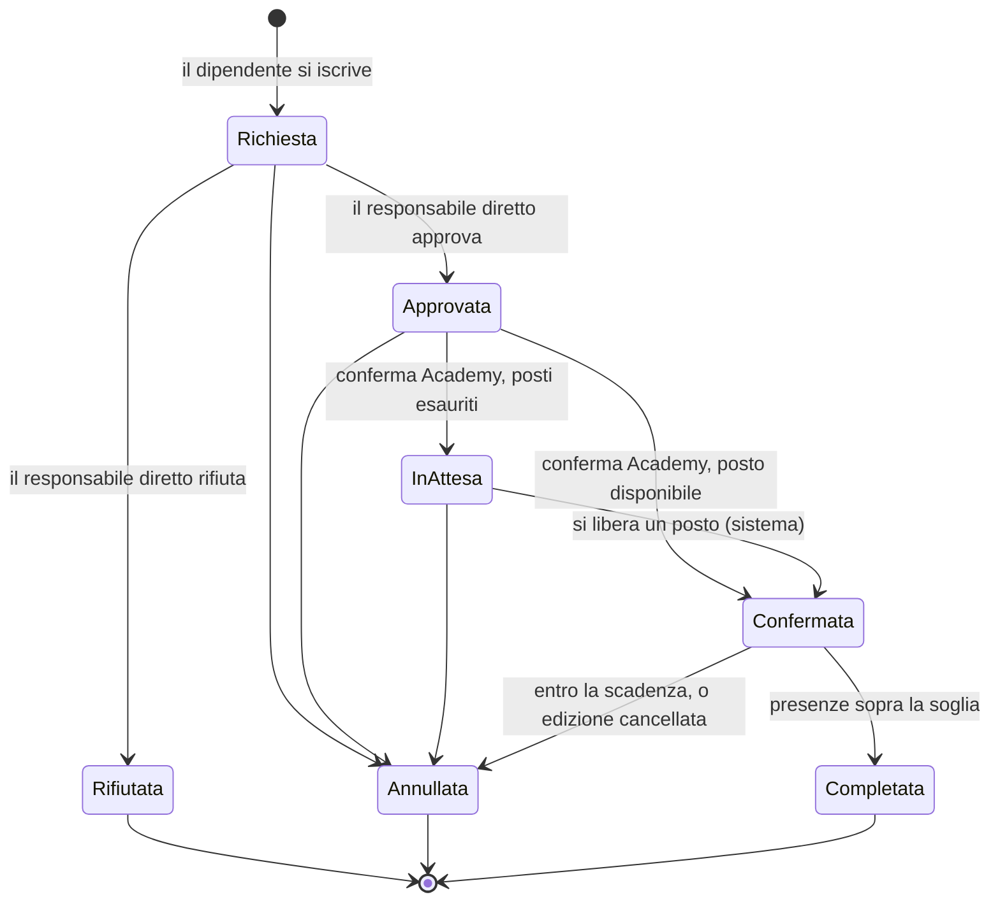

# Glossario del dominio

Termini usati in codice, test, issue e documentazione. Nel codice i nomi restano in italiano per le entità di dominio (`Iscrizione`, `Edizione`), così il linguaggio del business coincide con quello del codice.

## Entità

| Termine | Definizione | Da non confondere con |
|---|---|---|
| **Corso** | Un argomento di formazione con titolo, descrizione e durata in ore. Non ha date. | Edizione |
| **Edizione** | Un'istanza datata di un corso: data di inizio e fine, capienza, eventuale docente. Le iscrizioni si fanno sulle edizioni. | Corso |
| **Capienza** | Numero massimo di iscrizioni `Confermata` per un'edizione. | Numero di richieste |
| **Persona** | Un dipendente con nome, email e team. Ha un ruolo applicativo. | Utente di Keycloak o di Databricks (l'identità tecnica) |
| **Team** | Gruppo di persone con un solo responsabile. I team formano una gerarchia: ogni team, tranne quello al vertice, ha un team padre. | — |
| **Responsabile diretto** | Per un dipendente: il responsabile del suo team. Per un responsabile: il responsabile del team padre; al vertice, l'amministratore Academy. Conta quello in carica al momento della decisione. | Amministratore Academy |
| **Iscrizione** | La richiesta di una persona di partecipare a un'edizione, con il suo stato. | Presenza |
| **Iscrizione attiva** | Un'iscrizione in stato `Richiesta`, `Approvata`, `InAttesa` o `Confermata`. Al massimo una per persona ed edizione (R1). | — |
| **Lista d'attesa** | Le iscrizioni `InAttesa` di un'edizione, ordinate per momento di approvazione. | — |
| **Scadenza di annullamento** | Il numero N di giorni di calendario prima dell'inizio dell'edizione (fuso `Europe/Rome`) oltre il quale un'iscrizione `Confermata` non è più annullabile (R5). Configurabile per ambiente. | — |
| **Edizione cancellata** | Edizione ritirata dall'Academy prima dell'inizio. Resta nel database (cancellazione logica); le sue iscrizioni attive diventano `Annullata`. | Edizione conclusa |
| **Presenza** | Riga importata da file: una persona ha frequentato una giornata di un'edizione. | Iscrizione |
| **Soglia di completamento** | Percentuale minima di giornate presenti per passare a `Completata`. Predefinita 75%, configurabile. | — |
| **Valutazione** | Voto da 1 a 5 e commento facoltativo lasciati da chi ha completato un'edizione. Una per iscrizione, non modificabile. | — |
| **Sistema** | Autore degli eventi di audit generati dai job (promozione dalla lista d'attesa, scadenza all'inizio dell'edizione). | Amministratore Academy |
| **Evento di audit** | Registrazione immutabile di un cambio di stato: chi, quando, stato di partenza, stato di arrivo, motivo. | Log applicativo |

## Stati dell'iscrizione

Le transizioni consentite sono solo queste; ogni altra è rifiutata con un errore esplicito (R7). Decisioni D1–D11 in [docs/backlog.md](docs/backlog.md).

| Da | A | Chi | Condizione |
|---|---|---|---|
| — | `Richiesta` | dipendente | edizione non iniziata né cancellata; nessuna iscrizione attiva alla stessa edizione (R1) |
| `Richiesta` | `Approvata` / `Rifiutata` | responsabile diretto | non sulle proprie richieste (R2); motivo obbligatorio per il rifiuto |
| `Approvata` | `Confermata` / `InAttesa` | admin Academy | `Confermata` se ci sono posti (R3), altrimenti `InAttesa` |
| `InAttesa` | `Confermata` | sistema | primo in ordine di approvazione (R4); solo prima dell'inizio |
| `Richiesta`, `Approvata`, `InAttesa` | `Annullata` | titolare; sistema all'inizio dell'edizione; admin se cancella l'edizione | — |
| `Confermata` | `Annullata` | titolare; admin se cancella l'edizione | il titolare solo fino a N giorni prima dell'inizio (R5) |
| `Confermata` | `Completata` | importazione presenze | presenze ≥ soglia di completamento |

Un'iscrizione è **attiva** in `Richiesta`, `Approvata`, `InAttesa`, `Confermata`. Dopo `Rifiutata` o `Annullata` si può chiedere di nuovo l'iscrizione.

## Ruoli applicativi

| Ruolo | Codice |
|---|---|
| Dipendente | `dipendente` |
| Responsabile | `responsabile` |
| Amministratore Academy | `admin_academy` |
| Docente | `docente` |

Una persona può avere più ruoli: un responsabile è anche dipendente.

## Regole di business

| Codice | Regola |
|---|---|
| R1 | Al massimo una iscrizione attiva per persona ed edizione. |
| R2 | Solo il responsabile diretto approva; nessuno approva le proprie richieste. |
| R3 | Le iscrizioni confermate non superano mai la capienza, anche con conferme simultanee. |
| R4 | Un posto liberato passa al primo in lista d'attesa, in ordine di approvazione. |
| R5 | Un'iscrizione confermata è annullabile solo fino a N giorni prima dell'inizio. |
| R6 | Ogni cambio di stato genera un evento di audit. |
| R7 | Le transizioni non previste sono rifiutate con un errore esplicito. |

## Report

| Termine | Definizione |
|---|---|
| **Ore di formazione** | Somma delle ore dei corsi con iscrizione `Completata`, per persona o team. |
| **Tasso di completamento** | Iscrizioni `Completata` diviso iscrizioni `Confermata` o `Completata` di edizioni concluse. |
| **Quarantena** | Tabella che raccoglie le righe di un file importato che violano una regola di qualità non bloccante. |
| **Gate di qualità** | Controllo che impedisce l'aggiornamento delle tabelle gold se una regola bloccante fallisce. |
