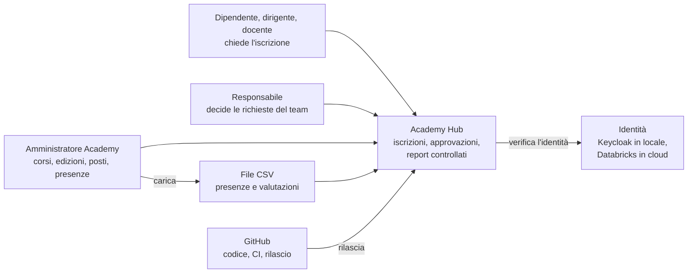
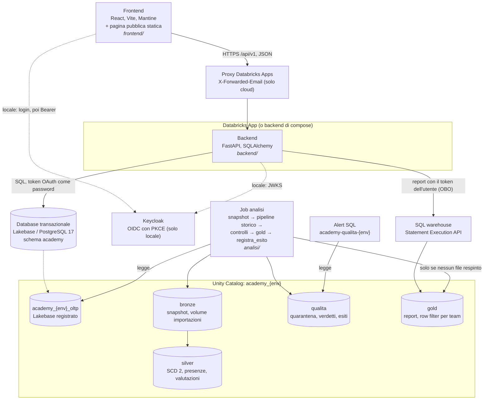
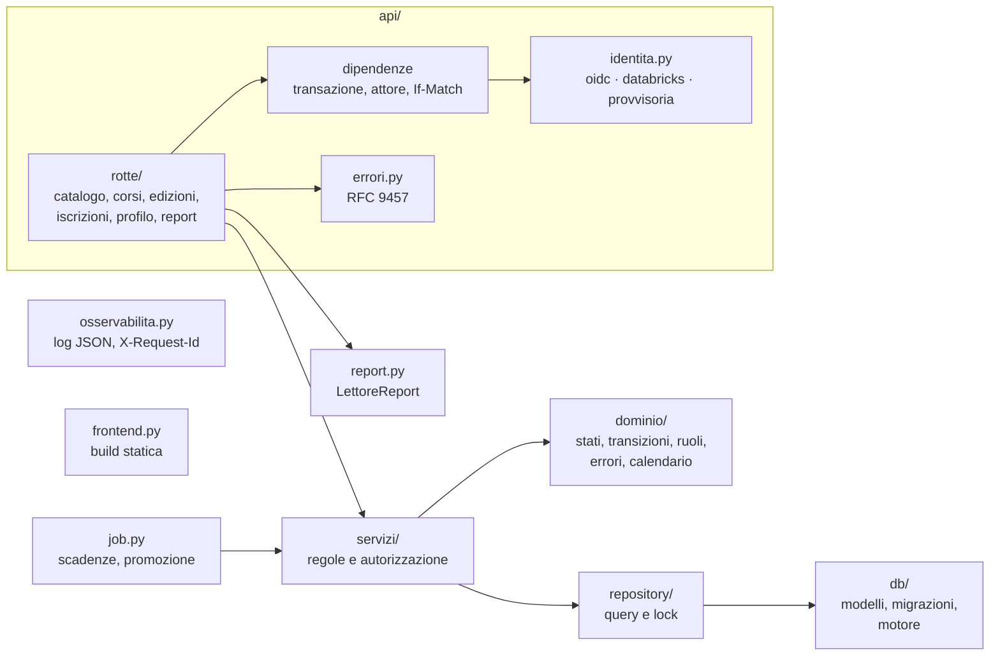
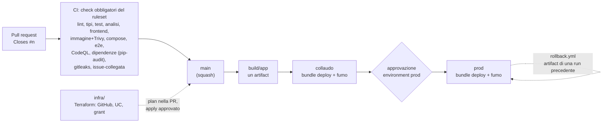

# Architettura

Diagrammi [C4](https://c4model.com/) in Mermaid: contesto, contenitori, componenti del backend, e il percorso dal commit alla produzione. Le scelte sono negli [ADR](adr/); i termini in [`CONTEXT.md`](../CONTEXT.md).

## 1. Contesto

Chi usa il sistema e con che cosa parla.

## 2. Contenitori

Un'App su Databricks Apps (backend FastAPI che serve anche il frontend), un database transazionale su Lakebase, la parte analitica in Unity Catalog. In locale gli stessi contenitori girano in docker compose, con Keycloak al posto del proxy di Databricks e PostgreSQL al posto di Lakebase.

- Frontend: l'App React per chi ha una sessione; chi non ce l'ha (login OIDC) arriva a `/benvenuto.html`, una pagina statica costruita con la taste-skill (ADR-0020).
- Identità: ADR-0008. App e Lakebase: ADR-0010. Report con l'identità dell'utente: ADR-0011, ADR-0018.
- Parte analitica: ADR-0016 (storico), ADR-0017 (importazioni, qualità, gold).
- Ambienti: `collaudo` e `prod`, ognuno con la sua App, il suo branch di Lakebase e il suo catalogo.

## 3. Componenti del backend

Regole: niente logica nelle rotte, niente SQL fuori dai repository, un solo punto per ogni cambio di stato dell'iscrizione con audit (R6), ogni posto liberato passa da `promuovi_dalla_lista` (R4), lock prima sull'edizione poi sulle iscrizioni (ADR-0004).

## 4. Dal commit alla produzione

Rilascio: ADR-0013. Rollback e DORA: ADR-0015. Infrastruttura: ADR-0012. Feature flag: ADR-0014.
