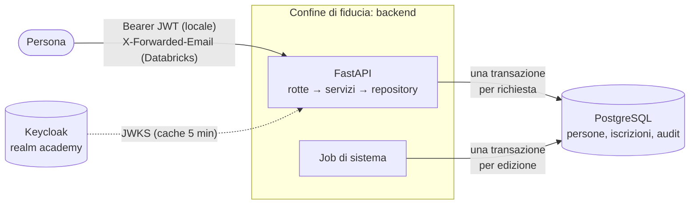

# Threat model del flusso di approvazione

- **Metodo:** STRIDE per elemento del flusso, sul sistema com'è alla fine della fase 6 (issue #56); aggiornato con il frontend servito dallo stesso processo (fase 7, issue #66) e con il rilascio continuo (fase 10, issue #82).
- **Perimetro:** richiesta, approvazione o rifiuto, conferma, annullamento, job di sistema. Della parte analitica su Databricks c'è solo la lettura dei report con l'identità dell'utente (ADR-0011); fuori perimetro le pipeline (fase 11) e Keycloak stesso. Del frontend (fase 7) ci sono le minacce sull'accesso e sul browser (XSS, clickjacking, file serviti).
- **Da rivedere:** quando cambia il provider d'identità, prima del primo deploy su Databricks Apps.

## Il sistema

| Passo | Rotta | Chi può (matrice in `backend/tests/test_autorizzazione.py`) |
|---|---|---|
| Richiesta | `POST /iscrizioni` | ruolo `dipendente`, per sé |
| Approvazione, rifiuto | `POST /iscrizioni/{id}/approvazione`, `/rifiuto` | solo il responsabile diretto del richiedente (R2), mai su sé stesso; per le richieste dal vertice un `admin_academy` |
| Conferma | `POST /iscrizioni/{id}/conferma` | `admin_academy` |
| Annullamento | `POST /iscrizioni/{id}/annullamento` | il titolare; se `Confermata`, solo entro la scadenza (R5) |
| Job | `python -m academy_hub.job` | nessuna rotta: processo con le credenziali del database |

Asset da proteggere: l'esito delle richieste (chi va al corso), i posti delle edizioni, la storia di audit, i dati personali minimi (nome, email, team).

## Difese che ci sono già

| Id | Difesa | Dove |
|---|---|---|
| D1 | Token OIDC verificato: solo RS256, chiavi dal JWKS, `iss`, `aud`, `exp`, `iat` obbligatori, `email_verified` | `api/identita.py`, ADR-0008 |
| D2 | Ruoli e team solo dal database, mai dal token o dagli header | `api/dipendenze.py`, ADR-0008 |
| D3 | Identità `provvisoria` (`X-Persona-Id`) e `databricks` rifiutate dalla configurazione fuori dall'ambiente giusto | `config.py` |
| D4 | Autorizzazione nei servizi, prima di leggere lo stato: chi non può decidere non scopre lo stato (R2 prima di R7) | `servizi/`, `dominio/organigramma.py` |
| D5 | Matrice rotta × profilo eseguita in CI, con profili dello stesso ruolo dentro e fuori dal rapporto con l'iscrizione (titolare, responsabile diretto); una rotta senza riga fa fallire i test | `tests/test_autorizzazione.py` |
| D6 | Transizioni ammesse in un solo punto, con audit nella stessa transazione | `servizi/iscrizioni.py`, R6, R7 |
| D7 | Audit append-only: un trigger blocca `UPDATE`, `DELETE`, `TRUNCATE` | migrazione 0001, `docs/database.md` |
| D8 | Lock in ordine fisso (edizione, poi iscrizioni), posti contati sotto lock, vincoli `CHECK` | ADR-0004 |
| D9 | Idempotenza della richiesta (`Idempotency-Key`), concorrenza ottimistica su corsi ed edizioni (`If-Match`) | ADR-0005, ADR-0006 |
| D10 | Errori RFC 9457 senza stack trace; il motivo del rifiuto del token solo nel log | `api/errori.py`, ADR-0008 |
| D11 | Input con limiti (lunghezze, paginazione al massimo 100, `extra="forbid"`) | `api/schemi.py` |
| D12 | Catena di fornitura: azioni fissate per SHA, immagini per digest, Dependabot, `pip-audit` su `uv.lock`, Trivy sull'immagine, CodeQL (Python e Actions), gitleaks e secret scanning con push protection | `.github/` |
| D13 | Container non root, porte di compose solo su `127.0.0.1` | `backend/Dockerfile`, `docker-compose.yml` |
| D15 | Report letti con il token dell'utente (on-behalf-of-user, scope `sql`): decide Unity Catalog; il service principal dell'App non ha grant su Unity Catalog; catalogo e schema come parametri, query fissa; token mai nei log; `Cache-Control: no-store` | `academy_hub/report.py`, `databricks.yml`, ADR-0011 |
| D14 | HTML dell'app con `Content-Security-Policy` (script solo dalla stessa origine, nessun `object`, `base-uri` e `form-action` limitati, `frame-ancestors 'none'`, rete solo verso l'app e l'emittente OIDC), `X-Content-Type-Options: nosniff`, `Referrer-Policy: no-referrer`; file serviti solo da dentro la build, `/api` mai coperto dal fallback | `academy_hub/frontend.py`, ADR-0009 §14 |
| D16 | Infrastruttura nel codice: ruleset, environment e permessi cambiano solo con una PR e un apply approvato nell'environment `infra` (policy sul ramo `main` per nome); token GitHub di sola lettura per il plan, quello che scrive solo nell'environment approvato; stato su HCP (cifrato, con lock), mai nel repository; deriva cercata ogni settimana | `infra/`, `.github/workflows/infra.yml`, ADR-0012 |
| D17 | Rilascio continuo solo da `main`: environment `collaudo` e `prod` limitati al ramo `main`, `prod` con approvatore e senza bypass degli admin; credenziali del service principal `academy-rilascio` solo nei secret degli environment (mai nel repository, mai sulla riga di comando); URL dell'App, host e id del workspace mascherati nei log pubblici prima del deploy; secret OAuth che ruota dopo 335 giorni (#80); `bundle deploy` senza `--auto-approve` | `.github/workflows/rilascio.yml`, `rilascia-ambiente.yml`, `infra/databricks-identita/`, ADR-0013 |
| D18 | Feature flag spente per difetto, controllate dall'API (404 prima dell'identità, il frontend nasconde solo); accensione in prod con una PR; evento `.ics` solo al titolare di un'iscrizione Confermata, `Cache-Control: no-store`; dati di prova sintetici (`@academy.example`) rifiutati dalla configurazione in `produzione` | `config.py`, `api/rotte/iscrizioni.py`, `db/dati_prova.py`, `databricks.yml`, ADR-0014 |
| D19 | Rollback solo a una run di `rilascio.yml` su `main` già riuscita in prod, con lo stesso artifact (nessuna build nuova) e la sua verifica dello SHA in `RILASCIO`; stesso workflow riusabile, stessi environment, approvazione di prod e concurrency del rilascio; `GITHUB_TOKEN` con `actions: read` solo per leggere run e artifact | `.github/workflows/rollback.yml`, `rilascia-ambiente.yml`, ADR-0015 |
| D20 | Dati analitici (bronze, silver) letti solo da `academy-rilascio` (proprietario delle tabelle; il proprietario del catalogo li legge solo dandosi un grant, che Terraform segnala come deriva); gli utenti leggono solo gold; Lakebase in Unity Catalog in sola lettura (il job non scrive mai sull'App); colonne copiate elencate una per una (nessun `SELECT *`), con un test che le lega al modello; grant del service principal del rilascio limitati agli schemi che scrive, in Terraform | `analisi/`, `infra/databricks/analisi.tf`, ADR-0016 |
| D21 | File importati trattati solo come dati: letti come testo, convertiti con `try_cast`/`try_to_date`, mai eseguiti né interpretati; regole di qualità con quarantena, file respinti da regole bloccanti o oltre il 10% di scarti, verdetto fissato per file; gold solo da file accettati; volume scrivibile da tutti solo in collaudo, in produzione solo dal proprietario del catalogo | `analisi/src/academy_analisi/qualita.py`, `gate.py`, `infra/databricks/qualita.tf`, ADR-0017 |

## Minacce

Stato: **mitigata** (una difesa la copre), **accettata** (rischio residuo consapevole, con il motivo), **aperta** (da fare, con la fase).

### S · Spoofing

| Minaccia | Passo | Difesa | Stato |
|---|---|---|---|
| Token falsificato o firmato con `alg: none` / HS256 con la chiave pubblica | tutti | D1 | mitigata |
| Token di un altro realm o per un altro servizio | tutti | D1 (`iss`, `aud`) | mitigata |
| Email non verificata usata per agganciare la persona di un altro | tutti | D1 (`email_verified`) | mitigata |
| `X-Persona-Id` o `X-Forwarded-Email` mandati a mano | tutti | D3 | mitigata fuori da `locale` e con `oidc`; in locale `provvisoria` permette di impersonare chiunque (voluto, per i test). Su Databricks verificato sull'App di collaudo (fase 8): senza token il proxy risponde 401, e un `X-Forwarded-Email` scritto dal client viene sostituito con quello dell'utente autenticato |
| Deploy senza `ACADEMY_AMBIENTE`: vale `locale`, quindi `provvisoria` passerebbe la validazione | tutti | D3: `provvisoria` esige `ACADEMY_AMBIENTE=locale` dichiarato, il default non basta (#58); il bundle imposta l'ambiente su Databricks | mitigata |
| Password del database letta da codice, configurazione o log dell'App | tutti | Su Lakebase nessuna password: token OAuth del service principal generato a ogni connessione, scade in un'ora (ADR-0010); email dell'amministratore e workspace fuori dal repository | mitigata |
| Dati di prod copiati nel branch di collaudo di Lakebase | tutti | lo schema di prod nel branch è del service principal di prod: l'App di collaudo non lo legge (ADR-0010) | accettata: dati sintetici; il proprietario del progetto li vede |
| Token rubato riusato fino alla scadenza | tutti | durata breve del token di Keycloak | accettata: niente binding (DPoP, mTLS) in un prototipo |
| Utente rinominato nel provider che prende l'email di un ex collega | tutti | email unica in `persone`; il cambio va fatto a mano | accettata (ADR-0008) |

### T · Tampering

| Minaccia | Passo | Difesa | Stato |
|---|---|---|---|
| Saltare l'approvazione (`Richiesta` → `Confermata`) | conferma | D6: la conferma parte solo da `Approvata` | mitigata |
| Approvare la propria richiesta, o quella di chi non dipende da me | approvazione | D4 (`AutoApprovazione`, `NonResponsabileDiretto`) | mitigata |
| Annullare l'iscrizione di un altro | annullamento | D4: solo il titolare | mitigata |
| Superare la capienza con conferme simultanee | conferma, annullamento, job | D8 | mitigata |
| Riscrivere o cancellare la storia | tutti | D7 | mitigata per l'app; un superutente del database può spegnere i trigger |
| Modifica di corso o edizione sopra quella di un altro | — | D9 | mitigata |
| CSV di presenze o valutazioni falsi per gonfiare ore di formazione o voti | importazioni | D21: in produzione carica solo il proprietario del catalogo; le righe devono corrispondere a persone ed edizioni vere, nei giorni dell'edizione | accettata: chi può caricare è fidato; il file resta nel volume e il verdetto dice quando è arrivato |
| Un file sbagliato che sporca i report | importazioni | D21: regole bloccanti e soglia del 10% respingono il file, il gold usa solo i file accettati | mitigata |
| Organigramma cambiato per farsi approvare da un complice | approvazione | nessuna rotta modifica team o responsabili: si cambiano solo nel database | accettata finché non c'è un'API dell'organigramma |

### R · Repudiation

| Minaccia | Passo | Difesa | Stato |
|---|---|---|---|
| «Non l'ho approvata io» | approvazione, rifiuto, conferma, annullamento | D6, D7: evento con autore, stato prima e dopo, istante del database | mitigata |
| Cambi fatti dal job senza autore | job | eventi con autore `NULL` = sistema, una transazione per edizione (ADR-0007) | mitigata |
| Log applicativi senza correlazione (chi, quale richiesta) | tutti | — | aperta: fase 9 (osservabilità, OpenTelemetry) |

### I · Information disclosure

| Minaccia | Passo | Difesa | Stato |
|---|---|---|---|
| Leggere l'iscrizione e la storia di un altro | lettura | D4: solo il titolare o `admin_academy` | mitigata |
| Scoprire che un'iscrizione esiste: per un id altrui la risposta è 403, non 404, e gli id sono sequenziali | lettura, decisioni, annullamento | — | accettata: rivela solo l'esistenza di un numero, non chi né dove |
| Elenco delle richieste altrui | US-07 | la query applica la stessa regola del decisore, verificata da un test | mitigata |
| Dettagli interni negli errori | tutti | D10 | mitigata |
| Evento di calendario di un'iscrizione altrui (titolo del corso, date) | calendario | D18, D4: solo il titolare, come la lettura dell'iscrizione | mitigata |
| Funzione non pronta usata in produzione chiamando l'API a mano | calendario | D18: da spenta la rotta risponde 404 anche ai client che la conoscono | mitigata |
| Report letti con i permessi dell'App invece che con quelli dell'utente | report | D15: il service principal non ha grant su Unity Catalog, la query usa il token dell'utente (`letto_come` lo mostra) | mitigata; il rifiuto per un altro utente è provato solo nei test (Free Edition ha un utente) |
| Token dell'utente (`X-Forwarded-Access-Token`) nei log o riusato dall'App | report | D15: mai registrato, usato solo per la query fissa del report, in memoria per la richiesta | mitigata |
| Segreti nel repository pubblico | — | D12 (gitleaks in pre-commit e in CI, push protection), solo dati sintetici | mitigata |
| `GET /configurazione` è pubblica e rivela emittente OIDC e client id del frontend | accesso | solo dati già visibili nella pagina di login; il client è pubblico (PKCE, nessun segreto) | accettata (fase 7, ADR-0009) |
| Access token rubato dal browser con uno script iniettato (XSS): con l'HTML sulla stessa origine dell'API uno script vale una sessione intera | tutti | React fa l'escape del testo, nessun HTML grezzo; D14 (CSP: niente script inline o di altre origini, dati mandati solo all'app o all'emittente); token in `sessionStorage`, non in `localStorage`; durata breve del token di Keycloak | mitigata; resta `style-src 'unsafe-inline'` per gli stili di Mantine (iniezione di CSS, non di script) |
| URL dell'App, host o id del workspace nei log pubblici dei workflow di rilascio | rilascio | D17: secret mascherati da GitHub; URL, host senza schema e id del workspace mascherati con `::add-mask::` prima del deploy, che si ferma se l'URL non si può leggere | mitigata; il workspace non è un segreto forte (senza credenziali non si entra), ma non serve renderlo pubblico |
| Dati personali (`persone.email`, ruoli, team) copiati fuori dall'App e letti da chi vede i report | analisi | D20: bronze e silver senza grant agli utenti; colonne esplicite, una nuova non arriva da sola | mitigata; l'oblio va fatto anche in bronze e silver (ADR-0016) |
| Formula o script in un commento di valutazione (`=HYPERLINK(...)`) che si esegue quando qualcuno apre i dati | importazioni | D21: il commento resta testo; nel frontend React fa l'escape | mitigata nell'App; chi esporta la quarantena in un foglio di calcolo deve aprirla come testo |
| File del server letti dal fallback della SPA (`../`, percorsi assoluti, collegamenti) | — | D14: percorso risolto e accettato solo dentro la build; test con un file sentinella accanto alla build | mitigata |

### D · Denial of service

| Minaccia | Passo | Difesa | Stato |
|---|---|---|---|
| Molte richieste da un utente autenticato | tutti | D11 (paginazione, lunghezze) | accettata: nessun limite di frequenza; in produzione lo darebbe il proxy di Databricks |
| Lock tenuti a lungo su un'edizione per bloccare le conferme | conferma, annullamento | transazioni brevi; il titolare dell'annullamento è controllato prima dei lock | mitigata in parte: un utente qualunque che tenta una decisione blocca per un attimo la riga dell'iscrizione |
| Percorsi con caratteri nulli che fanno sollevare un errore al file system (500 e righe di log a volontà, senza login) | — | D14: 404 prima di toccare il file system, con test | mitigata |
| Keycloak irraggiungibile | tutti | cache del JWKS 5 minuti, poi 503 `identita-non-disponibile` | accettata |
| Un file respinto che ferma i report di tutti | importazioni | D21: il verdetto è fissato, quindi blocca solo la passata in cui arriva; l'esito lo registra con il motivo | accettata: un giorno di report fermo; le notifiche arrivano nella PR B2 |
| File enorme caricato nel volume | importazioni | — | accettata: carica solo chi è fidato (in collaudo il workspace ha un utente) |
| Un'edizione che fa fallire il job ferma le altre | job | una transazione per edizione, errori isolati, uscita 1 (ADR-0007) | mitigata |

### E · Elevation of privilege

| Minaccia | Passo | Difesa | Stato |
|---|---|---|---|
| Ruoli inseriti nel token (`realm_access`) | tutti | D2: ignorati | mitigata |
| Clickjacking: l'app in un iframe di un altro sito per far cliccare «Approva» o «Conferma» | approvazione, conferma | D14 (`frame-ancestors 'none'`) | mitigata |
| Rotta nuova dimenticata senza controllo | tutti | D5 | mitigata per ruolo, titolare e responsabile diretto sulle rotte di oggi; per una rotta nuova con un controllo sull'oggetto diverso serve aggiungere il profilo che lo mette alla prova |
| `admin_academy` che decide al posto del responsabile | approvazione | D4: decide solo il responsabile diretto; l'admin solo per le richieste dal vertice | mitigata |
| Dipendenza vulnerabile (Python, immagine, azioni) | — | D12 | mitigata per le vulnerabilità note |
| Codice vulnerabile o workflow iniettabile | — | D12 (CodeQL `security-extended`, permessi minimi nei workflow) | mitigata in parte |
| Ruleset o environment allentati a mano dalla UI, o con un workflow modificato in una PR che legge i secret dell'infrastruttura | — | D16; il plan delle PR ha un token GitHub di sola lettura, le PR da fork non hanno secret; un ramo diverso da `main` non entra nell'environment `infra` | mitigata in parte: il token di HCP in `infra-plan` è un token utente e può scrivere lo stato (accettata: solo il proprietario apre rami); il proprietario resta amministratore e può cambiare tutto dalla UI (lo rileva il plan del lunedì) |
| Workflow su `main` compromesso (merge di una PR malevola o di un'azione di terze parti alterata) che usa le credenziali di `academy-rilascio`: il service principal è admin del workspace | rilascio | D17, D12 (azioni fissate per SHA), D5 e ruleset (ogni modifica passa da PR con CI verde); prod esige l'approvazione | accettata: admin necessario per App e Lakebase su Free Edition, dati sintetici, un solo sviluppatore (ADR-0013); con un account vero federation OIDC e un workspace per ambiente |
| Rollback a una versione vecchia con una vulnerabilità corretta dopo, o con un artifact diverso da quello rilasciato allora | rilascio | D19: solo run di `main` arrivate in prod e artifact non scaduti (90 giorni), SHA dell'artifact verificato, approvazione di prod; chi può avviare il workflow ha già scrittura sul repository | mitigata; la scelta della versione resta di chi approva |
| Dati di prova sintetici caricati in produzione (persone e iscrizioni finte nei report veri) | avvio | D18: `ACADEMY_DATI_PROVA` vietata con `ACADEMY_AMBIENTE=produzione`, l'App non parte; variabile del bundle spenta nel target `prod` | mitigata |

## Rischi accettati e limiti del piano gratuito

- Secret scanning per pattern generici (non legati a un provider) e controllo di validità dei segreti richiedono GitHub Advanced Security: restano spenti. Copre gitleaks.
- Nessun limite di frequenza, nessun binding del token, nessuna cifratura applicativa dei dati personali: sono dati sintetici di un prototipo.
- Il realm Keycloak di sviluppo ha password banali e il password grant (ADR-0008, punto 7): mai in un realm condiviso.
